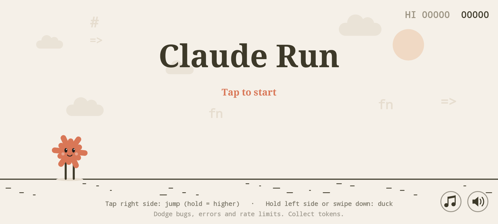
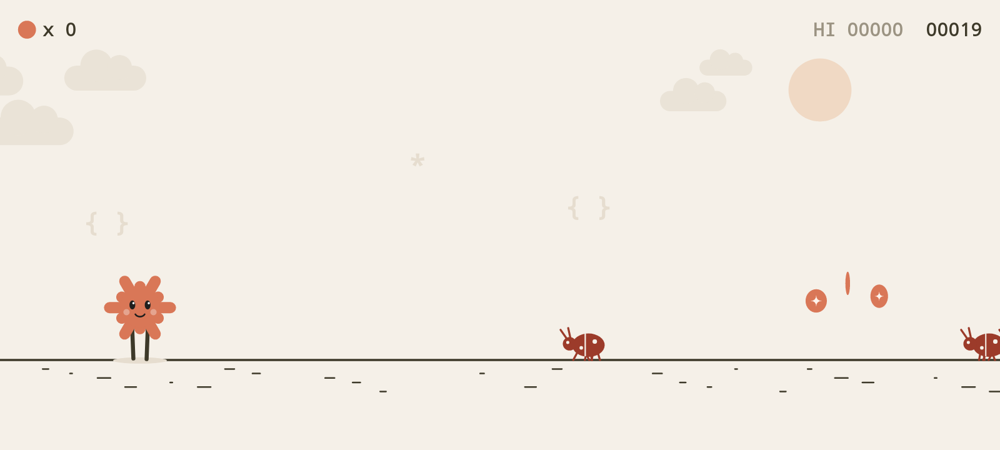
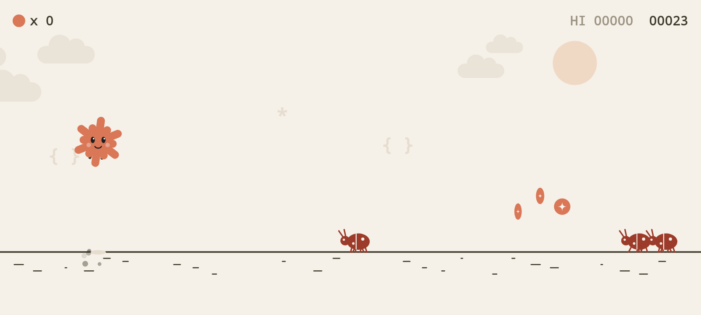
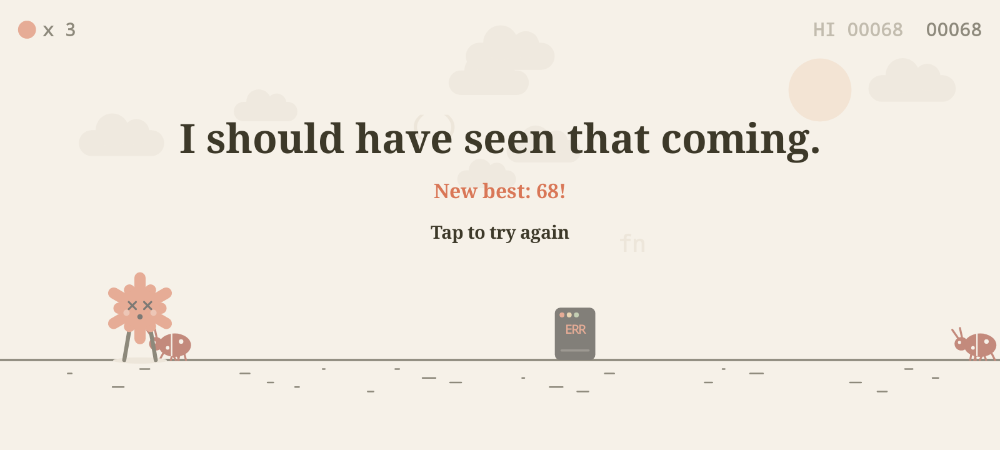
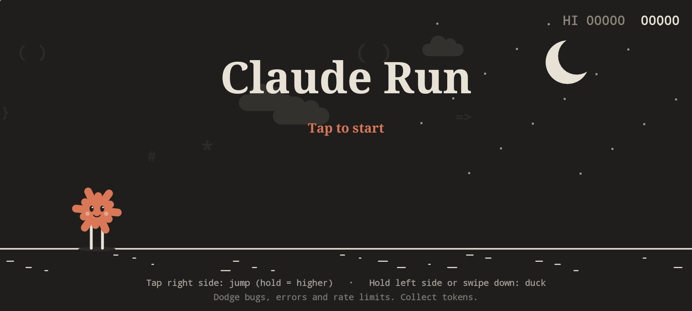
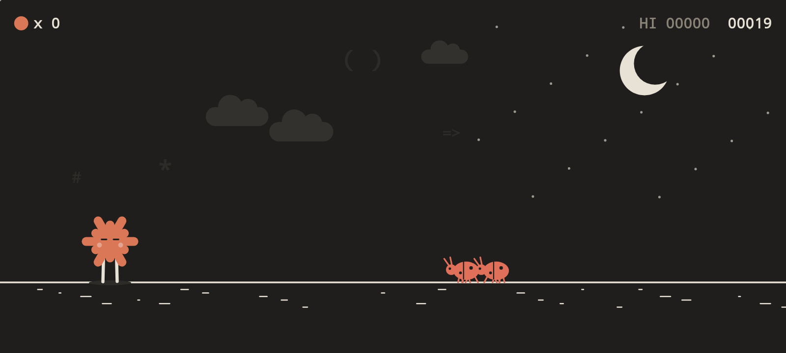

# Claude Run

A small endless-runner Android game starring Claude's orange spark. Jump over bugs and
error terminals, duck under `429` rate-limit clouds, and collect tokens for bonus points.
The world speeds up as you go, and day turns to night every 700 points.

**Dark mode:** the game follows your phone's system theme. With dark mode on, it plays
in the dark palette the whole time; switch the setting while playing and the colors fade
over without interrupting your run.

| Title | Running |
|---|---|
|  |  |
|  |  |
|  |  |

**Sound:** soft synth effects for jumping, ducking, collecting tokens (quick pickups chime
higher and higher), milestones, crashing and starting a run, plus a calm looping
background track that quietens on the game over screen. The two buttons in the
bottom-right corner of the title, pause and game over screens toggle the music (♫, or
press `N`) and the sound effects (speaker, or `M`); both choices are remembered. The
phone's volume buttons control the game volume. The effects are small WAV files; the
music is synthesized in code when the game starts.

**Full screen:** the game hides the status and navigation bars and draws behind the camera
notch / punch hole, while keeping the score and token counter clear of it.

## Controls

| Action | Touch | Keyboard |
|---|---|---|
| Jump (hold for a higher jump) | Tap / hold the right side of the screen | Space, ↑, W |
| Duck / fast-fall | Hold the left side, or swipe down | ↓, S |
| Music on / off | ♫ button (menus only) | N |
| Sound effects on / off | Speaker button (menus only) | M |

## Get the APK

- **Releases (easiest):** open the repo's **Releases** page and download
  `ClaudeRun-v<version>.apk` from the latest release, then open it on your phone (allow
  "install unknown apps"). Each release installs over the previous one and keeps your
  high score.
- **Any build:** every push and pull request runs the *Build APK* workflow; open the run
  in the **Actions** tab and download the `claude-run-apk` artifact.

### Publishing a release

Releases are automatic. When a push to `main` changes `versionName` in `app/build.gradle`,
the workflow builds the APK and publishes a release tagged `v<versionName>` with the APK
attached and the commits since the last release as notes. So to ship a new version, bump
`versionCode` and `versionName` and push to `main`. Pushes that don't change the version
just build. All APKs are signed with `app/debug.keystore`, which is committed so local
and CI builds share one signature (fine for sideloading; not meant for the Play Store).
- **Build locally:** with the Android SDK installed (or Android Studio), run

  ```sh
  ./gradlew assembleDebug
  # APK: app/build/outputs/apk/debug/app-debug.apk
  adb install app/build/outputs/apk/debug/app-debug.apk
  ```

Or just open the folder in Android Studio and press Run.

## Project layout

- `app/src/main/java/com/claudegame/run/GameView.java` — the whole game: physics,
  spawning, collisions and Canvas rendering (no image assets).
- `app/src/main/java/com/claudegame/run/MainActivity.java` — fullscreen landscape host.
- `app/src/main/res/raw/sfx_*.wav` — the sound effects (synthesized, no third-party audio).
- `app/src/main/java/com/claudegame/run/Sfx.java` — plays the effects via SoundPool.
- `app/src/main/java/com/claudegame/run/Synth.java` — tiny synthesizer that renders the
  music loop at startup.
- `app/src/main/java/com/claudegame/run/Music.java` — streams the gapless music loop.
- `app/src/test/.../GameViewRenderTest.java` — headless Robolectric test that plays the
  game and renders frames to `app/build/renders/` (`./gradlew testDebugUnitTest`).

Requires Android 8.0 (API 26) or newer.
